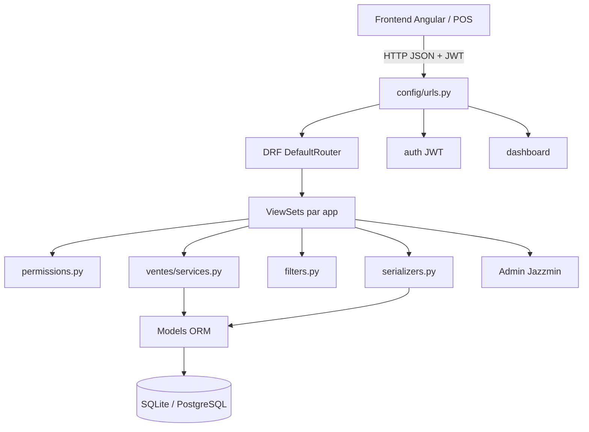
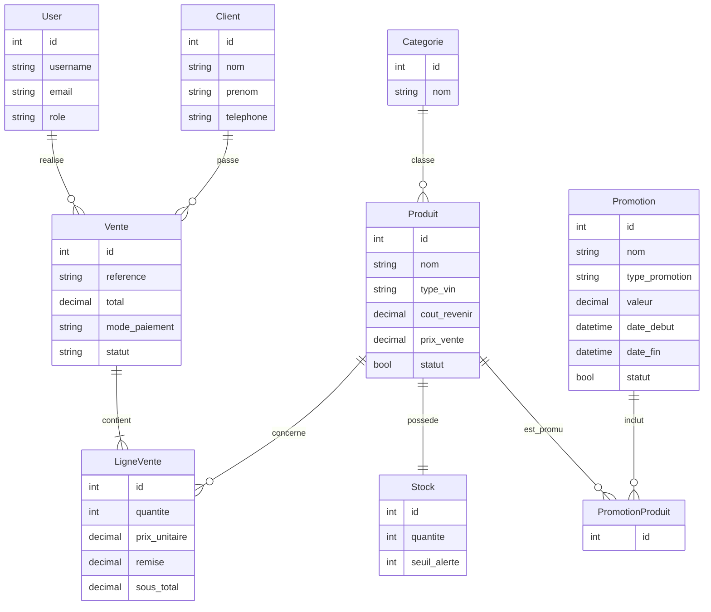
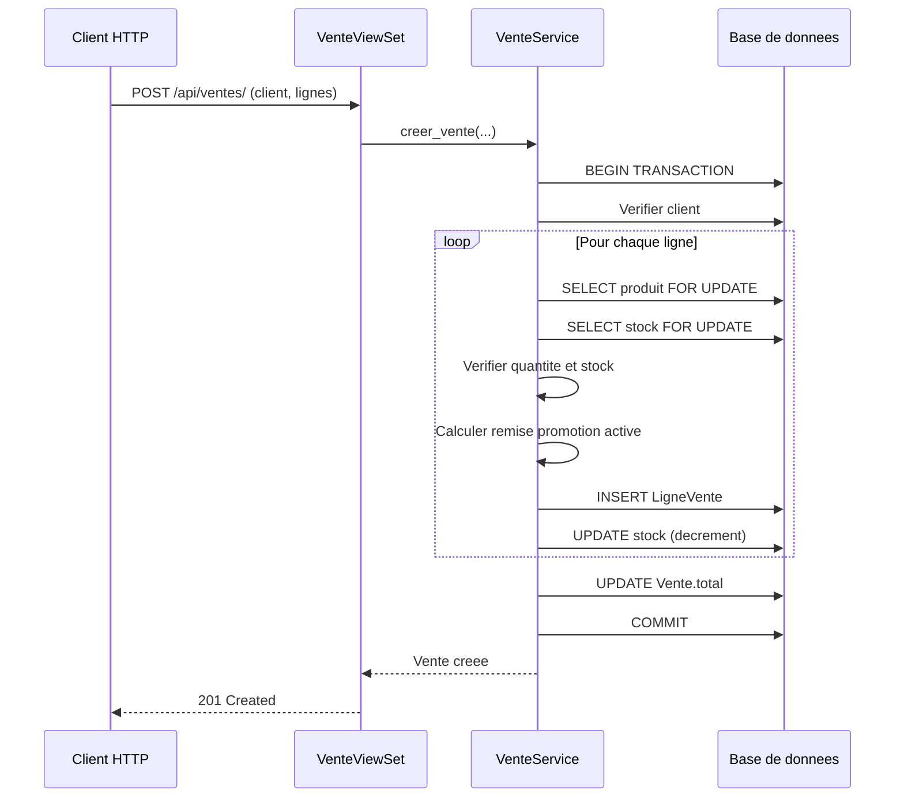
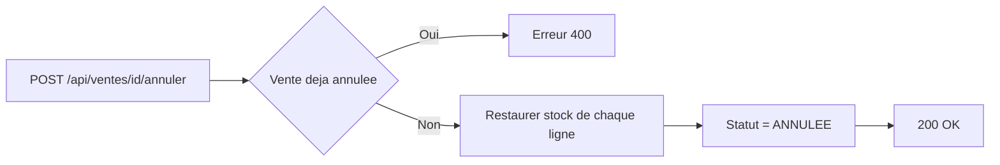

# Architecture du projet — Wine Management Backend

> Backend Django REST d'une application de gestion de vente et promotion du vin.
> Projet de mémoire — Licence 3 Informatique.

---

## 1. Vue d'ensemble

Le projet est un **monolithe Django modulaire** exposant une **API RESTful** (DRF) destinée à un frontend découplé (Angular). Il fournit également une **interface d'administration Django enrichie (Jazzmin)** et un **point de vente (POS)** basé sur un template.

| Élément | Valeur |
|---|---|
| Framework | Django 6.x |
| API | Django REST Framework 3.15 |
| Authentification | SimpleJWT (Bearer) |
| Base de données | SQLite (dev) — PostgreSQL prévu en prod |
| Filtrage | django-filter + SearchFilter + OrderingFilter |
| Documentation API | drf-spectacular (Swagger / ReDoc) |
| Admin UI | django-jazzmin (thème « lux ») |
| Tests | pytest-django + APITestCase |
| Langue / Fuseau | `fr-fr` / `Africa/Lome` |

---

## 2. Structure des dossiers

```text
backend/
├── config/                 # Configuration globale
│   ├── settings.py         # Settings, apps, DRF, JWT, Jazzmin
│   ├── settings_test.py    # Settings dédiés pytest (SQLite mémoire, ping désactivé)
│   ├── urls.py             # Routage racine + routeur DRF
│   ├── wsgi.py / asgi.py
├── apps/                   # Applications métier modulaires
│   ├── accounts/           # Utilisateur personnalisé + rôles + JWT
│   ├── categories/         # Catégories de vin
│   ├── clients/            # Clients
│   ├── produits/           # Catalogue des vins
│   ├── stocks/             # Quantités + seuils d'alerte
│   ├── promotions/         # Promotions (pourcentage / montant fixe)
│   ├── ventes/             # Ventes + lignes + service transactionnel
│   ├── fournisseurs/       # Fournisseurs et partenaires
│   ├── commandes/          # Achats, réceptions partielles et mise à jour du stock
│   └── dashboard/          # Statistiques agrégées
├── templates/admin/        # Templates admin (index, pos, facture)
├── tests/                  # Tests d'intégration API
├── static/  media/  logs/
├── seed.py                 # Jeu de données de démonstration
├── manage.py  pytest.ini  requirements.txt
```

Chaque app suit une structure homogène : `models.py`, `serializers.py`, `views.py`, `admin.py`, `filters.py` (si filtrage), `migrations/`, `tests.py`.

Les applications `fournisseurs` et `commandes` sont enregistrées dans
`INSTALLED_APPS` et exposées par le routeur REST (`/api/fournisseurs/` et
`/api/commandes/`). Les rapports sont disponibles sous `/api/rapports/ventes/`
avec regroupement par période ou dimension commerciale et export CSV.

Le rôle `GESTIONNAIRE` dispose des mêmes droits de gestion que `ADMIN` dans
l'interface et les API métier. Le rôle `VENDEUR` conserve ses droits de caisse
et de gestion client. Le rôle est inclus dans la migration
`accounts.0005_user_gestionnaire_role`.

---

## 3. Architecture applicative (couches)



**Principes observés :**
- Séparation **Vue → Serializer → Modèle** classique DRF.
- La logique métier complexe (vente) est isolée dans un **service** ([`VenteService`](apps/ventes/services.py:11)) plutôt que dans la vue.
- Les permissions sont centralisées dans [`apps/accounts/permissions.py`](apps/accounts/permissions.py:1) et réutilisées par les ViewSets.

---

## 4. Modèle de données (ERD)



### Relations clés
- **User** : `AbstractUser` personnalisé, `AUTH_USER_MODEL = accounts.User`, rôles `ADMIN` / `VENDEUR`.
- **Produit → Stock** : relation `OneToOne` (un stock par produit).
- **Produit → Categorie** : `ForeignKey` avec `on_delete=SET_NULL`.
- **Produit → Fournisseur** : `ForeignKey` avec `on_delete=PROTECT` (le fournisseur d'une cuvée achetée reste dans l'historique).
- **BonCommande → Fournisseur** : `ForeignKey` avec `on_delete=PROTECT`.
- **LigneBonCommande → Produit** : `PROTECT`, le prix d'achat est figé sur la ligne au moment de la commande.
- **Vente → Client / User** : `ForeignKey` avec `on_delete=PROTECT` (empêche la suppression d'un client/vendeur ayant des ventes).
- **Vente → LigneVente** : `CASCADE` (les lignes disparaissent avec la vente).
- **LigneVente → Produit** : `PROTECT` (un produit vendu ne peut être supprimé).
- **Promotion ↔ Produit** : `ManyToMany` via table explicite `PromotionProduit` avec contrainte d'unicité.

---

## 5. Flux métier clés

### 5.1 Création d'une vente (transactionnel)



Points d'attention :
- Décorateur [`@transaction.atomic`](apps/ventes/services.py:47) : toute erreur annule l'ensemble.
- [`select_for_update()`](apps/ventes/services.py:74) sur produit et stock : verrouillage pessimiste contre les accès concurrents.
- La référence de vente est générée automatiquement au format `CMD-XXXXXXXX` ([`Vente.save()`](apps/ventes/models.py:52)).

### 5.2 Annulation d'une vente



- Restauration du stock ligne par ligne ([`annuler_vente()`](apps/ventes/services.py:127)).
- Protection contre la double annulation.
- Réservée aux administrateurs via [`CanManageVentes`](apps/accounts/permissions.py:41).

### 5.3 Application des promotions

- Recherche des promotions **actives** (statut + fenêtre de dates) liées au produit ([`calculer_remise_produit()`](apps/ventes/services.py:13)).
- Type `POURCENTAGE` : `remise = prix * valeur / 100`.
- Type `MONTANT_FIXE` : `remise = valeur`.
- Le prix final est borné à 0 (remise plafonnée au prix unitaire).
- En cas de promotions multiples, la **plus avantageuse** (remise la plus élevée) est retenue.
- Validations métier : `date_fin >= date_debut`, valeur strictement positive, et pourcentage plafonné à 100 % ([`Promotion.clean()`](apps/promotions/models.py:46) + serializer).

---

## 6. Endpoints API

### Authentification (`/api/auth/`)
| Méthode | URL | Description |
|---|---|---|
| POST | `/api/auth/login/` | Obtention du token (access + refresh) |
| POST | `/api/auth/refresh/` | Rafraîchissement du token |
| GET | `/api/auth/me/` | Profil de l'utilisateur connecté |

### Ressources (routeur DRF, `/api/`)
| Ressource | URL de base | ViewSet |
|---|---|---|
| Utilisateurs | `/api/utilisateurs/` | [`UserViewSet`](apps/accounts/views.py:9) |
| Clients | `/api/clients/` | [`ClientViewSet`](apps/clients/views.py:1) |
| Catégories | `/api/categories/` | [`CategorieViewSet`](apps/categories/views.py:1) |
| Fournisseurs | `/api/fournisseurs/` | [`FournisseurViewSet`](apps/fournisseurs/views.py:1) |
| Bons de commande | `/api/commandes/` | [`BonCommandeViewSet`](apps/commandes/views.py:1) |
| Produits | `/api/produits/` | [`ProduitViewSet`](apps/produits/views.py:7) |
| Stocks | `/api/stocks/` | [`StockViewSet`](apps/stocks/views.py:1) |
| Promotions | `/api/promotions/` | [`PromotionViewSet`](apps/promotions/views.py:1) |
| Ventes | `/api/ventes/` | [`VenteViewSet`](apps/ventes/views.py:12) |
| Annulation vente | `/api/ventes/{id}/annuler/` | action custom |

### Autres
| Méthode | URL | Description |
|---|---|---|
| GET | `/api/dashboard/` | Statistiques agrégées |
| GET | `/api/docs/` | Swagger UI |
| GET | `/api/redoc/` | ReDoc |
| GET | `/api/schema/` | Schéma OpenAPI |
| GET | `/admin/caisse/` | Interface POS |
| GET | `/admin/` | Admin Jazzmin |

---

## 7. Matrice des permissions

| Ressource | Lecture | Écriture | Permission appliquée |
|---|---|---|---|
| Utilisateurs | Admin | Admin | [`IsAdmin`](apps/accounts/permissions.py:4) |
| Produits | Authentifié | Admin | [`IsAdminOrReadOnly`](apps/accounts/permissions.py:18) |
| Catégories | Authentifié | Admin | [`IsAdminOrReadOnly`](apps/categories/views.py:9) |
| Fournisseurs / Bons de commande | Authentifié | Admin | [`IsAdminOrReadOnly`](apps/accounts/permissions.py) |
| Stocks | Authentifié | Admin | [`IsAdminOrReadOnly`](apps/stocks/views.py:12) |
| Promotions | Authentifié | Admin | [`IsAdminOrReadOnly`](apps/promotions/views.py:9) |
| Mouvements de stock | Authentifié | Lecture seule | `IsAuthenticated` |
| Clients | Admin + Vendeur | Admin + Vendeur | [`CanManageClients`](apps/accounts/permissions.py:30) |
| Ventes | Admin + Vendeur | Création : Admin + Vendeur / Annulation : Admin | [`CanManageVentes`](apps/accounts/permissions.py:41) |
| Dashboard | Authentifié | — | `IsAuthenticated` |

---

## 8. Configuration & sécurité

- **Variables d'environnement** via `django-environ` (`.env`), avec valeurs par défaut sûres.
- **JWT** : access 60 min, refresh 1 jour, header `Bearer`.
- **CORS** : `CORS_ALLOW_ALL_ORIGINS = False` par défaut ; seules les origines listées (localhost:4200) sont autorisées.
- **Pagination** : `PageNumberPagination`, 20 éléments.
- **Base de données** : PostgreSQL via variables `.env`, avec repli automatique sur SQLite si PostgreSQL est injoignable (idéal en dev). Le ping de contrôle au démarrage est configurable (`DB_CONNECT_TIMEOUT`, `DB_SKIP_FALLBACK_PING`) ; les tests utilisent `config/settings_test.py` (SQLite en mémoire).
- **SECRET_KEY** : en production (`DEBUG=False`), le serveur refuse de démarrer si la clé de secours du développement est utilisée (`ImproperlyConfigured`).
- **Validation de mot de passe** : validateurs Django standards activés.
- **Fichiers** : `STATIC_ROOT` / `MEDIA_ROOT` créés dynamiquement au démarrage.

---

## 9. Tests

| Fichier | Couverture |
|---|---|
| [`tests/test_auth.py`](tests/test_auth.py:1) | Authentification / JWT |
| [`tests/test_clients.py`](tests/test_clients.py:1) | CRUD clients |
| [`tests/test_fournisseurs.py`](tests/test_fournisseurs.py:1) | Registre des fournisseurs |
| [`tests/test_commandes.py`](tests/test_commandes.py:1) | Bons de commande, réceptions, couverture |
| [`tests/test_produits.py`](tests/test_produits.py:1) | CRUD produits + filtres |
| [`tests/test_promotions.py`](tests/test_promotions.py:1) | CRUD promotions + validations |
| [`tests/test_ventes_stocks.py`](tests/test_ventes_stocks.py:15) | Vente, stock insuffisant, promotion, annulation |
| [`tests/test_dashboard.py`](tests/test_dashboard.py:1) | Statistiques du tableau de bord |
| [`tests/test_dashboard_ventes_par_jour.py`](tests/test_dashboard_ventes_par_jour.py:1) | Série temps CA/jour |

Le test [`test_ventes_stocks.py`](tests/test_ventes_stocks.py:15) valide les scénarios critiques : stock suffisant, stock insuffisant (rollback), application de promotion, restauration du stock à l'annulation.

---

## 10. Points forts

- Architecture modulaire claire, une app par domaine métier.
- Logique métier transactionnelle isolée dans un service testable.
- Verrouillage pessimiste (`select_for_update`) pour la cohérence des stocks.
- Documentation API auto-générée (OpenAPI).
- Jeu de données de démonstration (`seed.py`) et tests d'intégration présents.
- Admin personnalisé avec POS intégré.

## 11. Risques & recommandations

| # | Constat | Statut / Recommandation |
|---|---|---|
| 1 | CORS restreint par défaut | ✅ Résolu — `CORS_ALLOW_ALL_ORIGINS = False` |
| 2 | Promotions : avantage retenu | ✅ Résolu — la remise la plus avantageuse est appliquée |
| 3 | Validations promotions faibles | ✅ Résolu — `date_fin >= date_debut`, valeur > 0, % ≤ 100 (modèle + serializer) |
| 4 | `except Exception` générique dans les vues ventes | ✅ Amélioré — erreurs typées (ValidationError 400, IntegrityError 409), journalisation avec traceback |
| 5 | Permissions sur apps secondaires | ✅ Résolu — `IsAdminOrReadOnly` sur catégories, produits, stocks, promotions, fournisseurs, commandes |
| 6 | Temps d'exécution des tests | ✅ Résolu — `config/settings_test.py` : SQLite en mémoire (`pytest.ini`) et ping PostgreSQL désactivé |
| 7 | `SECRET_KEY` et mot de passe DB dans `.env` | ✅ Amélioré — démarrage refusé en prod sans `SECRET_KEY` forte ; `.env` reste dans `.gitignore` |
| 8 | `DEBUG=True` dans `.env` | ⚠️ À passer à `False` en production |
| 9 | Pas de remise manuelle par ligne | 💡 Envisager une remise saisie par le vendeur (avenir) |
| 10 | Pas de journal d'audit des actions admin | 💡 Envisager `django-auditlog` (avenir) |

---

## 12. Résumé

Le projet suit une architecture **Django monolithique modulaire** bien structurée, avec une séparation nette des responsabilités (modèles, serializers, vues, services, permissions). Le cœur métier — la vente transactionnelle avec gestion de stock et promotions — est correctement isolé et testé. Les principaux axes d'amélioration concernent la **sécurité de configuration** (CORS, SECRET_KEY, DB), la **robustesse des permissions** sur les apps secondaires, et l'**enrichissement de la logique de promotion**.
