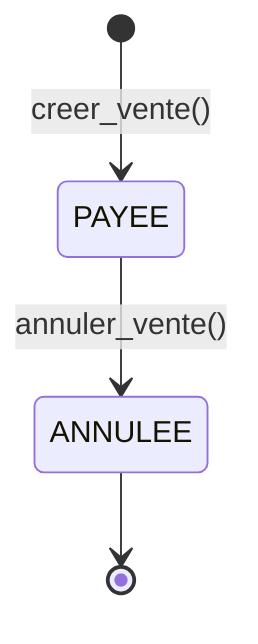
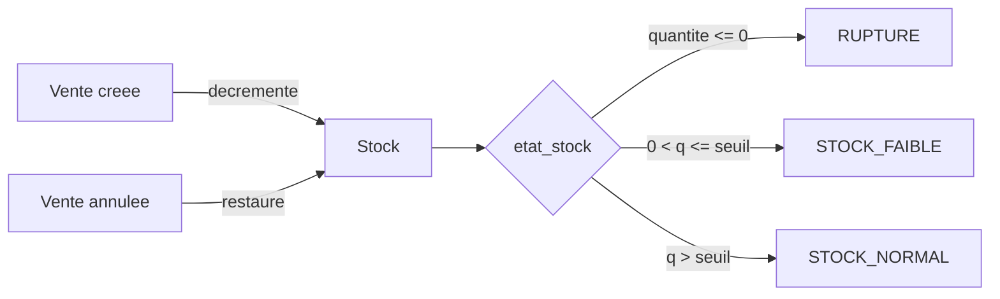
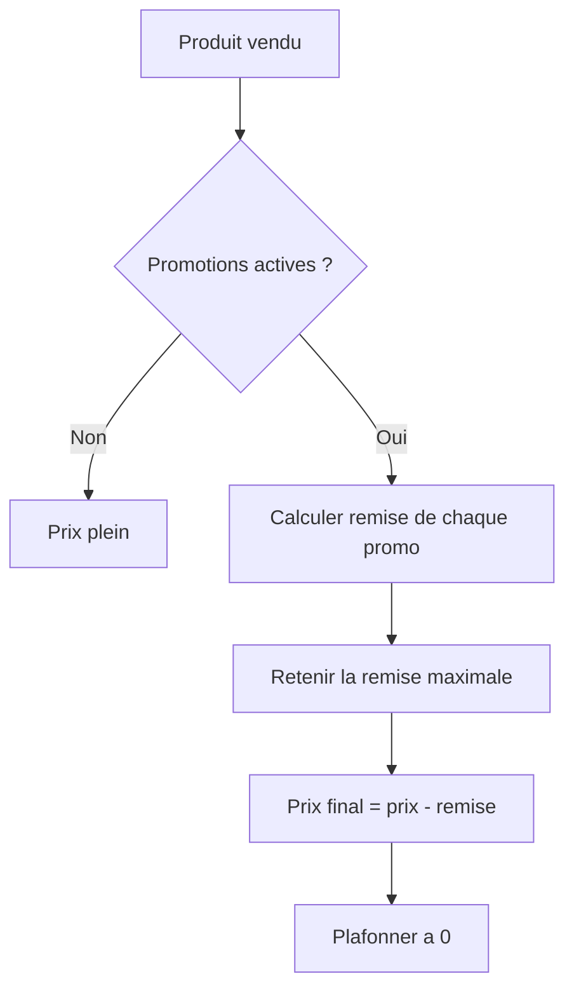

# Logique d'action du projet — Wine Management Backend

> Référence de la logique métier (règles, invariants, workflows) de chaque application.
> À utiliser comme guide d'implémentation et de maintenance.

---

## 1. Principes directeurs

| Principe | Application dans le projet |
|---|---|
| **Une app = un domaine** | Chaque entité métier a son app dédiée |
| **Logique métier dans les services** | Les calculs complexes (vente) sont dans [`VenteService`](apps/ventes/services.py:11), pas dans les vues |
| **Atomicité** | Toute opération multi-écritures est `@transaction.atomic` |
| **Verrouillage pessimiste** | `select_for_update()` sur produit et stock lors d'une vente |
| **Permissions centralisées** | [`apps/accounts/permissions.py`](apps/accounts/permissions.py:1) réutilisé partout |
| **Séparation lecture/écriture** | Serializers `*DetailSerializer` pour la lecture, `*Serializer` pour l'écriture |

---

## 2. Logique par application

### 2.1 `accounts` — Utilisateurs & rôles

**Règles métier**
- `email` est **obligatoire et unique** ([`UserManager.create_user()`](apps/accounts/models.py:10)).
- Deux rôles : `ADMIN` et `VENDEUR` (défaut `VENDEUR`).
- Un superutilisateur est automatiquement `ADMIN` ([`create_superuser()`](apps/accounts/models.py:22)).
- Le mot de passe est toujours haché via `set_password()` ([`UserSerializer`](apps/accounts/serializers.py:13)).

**Actions autorisées**
| Action | Qui | Endpoint |
|---|---|---|
| Se connecter | Tous | `POST /api/auth/login/` |
| Rafraîchir le token | Tous | `POST /api/auth/refresh/` |
| Voir son profil | Authentifié | `GET /api/auth/me/` |
| CRUD utilisateurs | Admin uniquement | `/api/utilisateurs/` |

**Invariant** : un utilisateur ne peut jamais être supprimé s'il a des ventes (`on_delete=PROTECT`).

---

### 2.2 `categories` — Catégories de vin

**Règles métier**
- `nom` **unique** ([`Categorie.nom`](apps/categories/models.py:5)).
- `statut` booléen pour activer/désactiver sans supprimer.
- Tri alphabétique par défaut.

**Actions** : CRUD réservé aux admins en écriture, lecture pour tout authentifié ([`IsAdminOrReadOnly`](apps/accounts/permissions.py:18)).

**Invariant** : la suppression d'une catégorie ne supprime pas les produits (`on_delete=SET_NULL`).

---

### 2.3 `fournisseurs` & `commandes` — Approvisionnement

La cave n'est pas un domaine : elle **achète** ses cuvées. Elle tient un registre
de ses sources, commande le réassort, et le stock entre par la **réception d'un
bon de commande**. Les deux apps partagent une seule section de navigation,
« Approvisionnements » ([`sidebar_label`](apps/accounts/templatetags/accounts_tags.py:57)).

**Règles métier — fournisseurs**
- Un fournisseur porte un type (coopérative, viticulteur, grossiste), un contact
  et un `statut` qui permet de le retirer du catalogue sans le supprimer.
- Chaque produit a au plus un fournisseur et un prix d'achat : le coût retenu
  pour la marge est le prix d'achat s'il existe, sinon le coût de revient
  ([`cout_effectif_expression`](apps/produits/couts.py:8)).
- Un fournisseur référencé par un produit ou un bon de commande est protégé
  (`on_delete=PROTECT`) ; il reste dans l'historique d'achat.

**Règles métier — bons de commande**
- Un bon appartient à un fournisseur, et **toutes** ses lignes doivent porter un
  produit de ce même fournisseur ([`creer_bon_commande`](apps/commandes/services.py:82)).
- Un produit ne peut apparaître qu'une fois sur un bon.
- Le prix unitaire est repris du produit s'il n'est pas saisi, et figé sur la
  ligne : un changement de tarif ultérieur ne réécrit pas l'historique.
- Créer un bon ne touche pas au stock ; seule la **réception** écrit les
  `MouvementStock` de type `ENTREE` et met à jour le stock
  ([`recevoir_bon_commande`](apps/commandes/services.py:170)).
- Quantité reçue plafonnée au restant attendu ; une réception partielle laisse
  le bon en `PARTIELLE` et reste complétable.
- Un bon réceptionné ou annulé est clôturé : il ne se modifie plus.

**Actions** : CRUD admin en écriture, lecture pour authentifiés
([`IsAdminOrReadOnly`](apps/accounts/permissions.py:18)).

**Invariant** : le stock ne peut qu'augmenter par une réception, et jamais
au-delà de la quantité commandée.

---

### 2.4 `clients` — Clients

**Règles métier**
- `nom`, `prenom`, `telephone` obligatoires ; `email` et `adresse` optionnels.
- Tri par date de création décroissante.

**Actions** : CRUD ouvert aux **admins ET vendeurs** ([`CanManageClients`](apps/accounts/permissions.py:30)) — un vendeur doit pouvoir créer un client au comptoir.

**Invariant** : un client avec des ventes ne peut pas être supprimé (`on_delete=PROTECT`).

---

### 2.5 `produits` — Catalogue des vins

**Règles métier**
- Champs obligatoires : `nom`, `type_vin`, `marque`, `volume`, `prix_achat`, `prix_vente`.
- `millesime` optionnel (année).
- `statut` : produit actif/inactif.
- `image` uploadée dans `media/produits/`.
- Tri par date de création décroissante.

**Actions**
| Action | Qui |
|---|---|
| Consulter / rechercher / filtrer | Authentifié |
| Créer / modifier / supprimer | Admin |
| Marquer disponible/indisponible (admin) | Admin |

**Filtres disponibles** ([`ProduitFilter`](apps/produits/filters.py:4)) : `prix_min`, `prix_max`, `nom` (icontains), `categorie`, `type_vin`, `marque`, `statut`.

**Invariant** : un produit vendu ne peut pas être supprimé (`LigneVente.produit` en `PROTECT`).

**⚠️ Règle manquante recommandée** : `prix_vente >= prix_achat` (marge non négative).

---

### 2.6 `stocks` — Suivi quantitatif

**Règles métier**
- Relation **OneToOne** avec `Produit` : un seul stock par produit.
- `quantite >= 0` et `seuil_alerte >= 0` (validateurs).
- `seuil_alerte` par défaut = 10.

**États calculés** ([`Stock.etat_stock`](apps/stocks/models.py:33))
| État | Condition |
|---|---|
| `RUPTURE` | `quantite <= 0` |
| `STOCK_FAIBLE` | `0 < quantite <= seuil_alerte` |
| `STOCK_NORMAL` | `quantite > seuil_alerte` |

**Actions** : CRUD admin en écriture, lecture pour authentifiés. Édition rapide (`quantite`, `seuil_alerte`) dans l'admin.

**Invariant** : le stock ne peut jamais devenir négatif — contrôlé dans [`creer_vente()`](apps/ventes/services.py:88).

---

### 2.7 `promotions` — Réductions

**Règles métier**
- Deux types : `POURCENTAGE` (ex. 15 %) ou `MONTANT_FIXE` (ex. 5 €).
- `valeur >= 0`.
- Fenêtre de validité : `date_debut` → `date_fin`.
- `statut` booléen (actif/inactif).
- Association N-N aux produits via [`PromotionProduit`](apps/promotions/models.py:55) avec **unicité** (promotion, produit).

**État calculé** ([`Promotion.est_active`](apps/promotions/models.py:49))
```python
statut AND date_debut <= now <= date_fin
```

**Actions** : CRUD admin, activation/désactivation en masse, filtres `active` et `date`.

**Invariant** : une promotion inactive ou hors période n'est jamais appliquée.

---

### 2.8 `ventes` — Cœur métier (transactionnel)

**Règles métier**
- Une vente a **au moins une ligne**.
- `reference` auto-générée : `CMD-XXXXXXXX` (UUID tronqué).
- `total` = somme des sous-totaux des lignes.
- Statuts : `PAYEE` (défaut) ou `ANNULEE`.
- Modes de paiement : `ESPECES`, `MOBILE_MONEY`, `CARTE`.

**Calcul d'une ligne**
```
prix_unitaire   = produit.prix_vente
remise_unitaire = meilleure promotion active (pourcentage ou fixe)
sous_total      = (prix_unitaire - remise_unitaire) * quantite
```

**Workflow de création** ([`VenteService.creer_vente()`](apps/ventes/services.py:48))
1. Vérifier l'existence du client
2. Vérifier qu'il y a au moins une ligne
3. Créer la vente (total provisoire = 0)
4. Pour chaque ligne :
   - Verrouiller le produit (`select_for_update`)
   - Valider la quantité > 0
   - Verrouiller le stock et vérifier la disponibilité
   - Calculer la remise (meilleure promotion active)
   - Créer la `LigneVente`
   - Décrémenter le stock
5. Mettre à jour le total de la vente
6. Commit atomique

**Workflow d'annulation** ([`VenteService.annuler_vente()`](apps/ventes/services.py:127))
1. Verrouiller la vente
2. Refuser si déjà annulée
3. Restaurer le stock de chaque ligne
4. Passer le statut à `ANNULEE`

**Actions**
| Action | Qui |
|---|---|
| Lister / consulter | Admin + Vendeur |
| Créer | Admin + Vendeur |
| Annuler | Admin uniquement |

**Invariants**
- Le stock ne devient jamais négatif.
- Une vente annulée ne peut pas être ré-annulée.
- Toute erreur annule l'intégralité de la transaction (rollback).

---

### 2.9 `dashboard` — Statistiques

**Indicateurs calculés** ([`DashboardView`](apps/dashboard/views.py:15))
| Indicateur | Calcul |
|---|---|
| `total_produits` | `Produit.count()` |
| `total_clients` | `Client.count()` |
| `total_ventes` | Ventes `PAYEE` |
| `chiffre_affaires` | `Sum(total)` des ventes `PAYEE` |
| `stock_faible` | `0 < quantite <= seuil_alerte` |
| `produits_rupture` | `quantite <= 0` |
| `promotions_actives` | Promotions dans la fenêtre de validité |
| `ventes_recentes` | 5 dernières ventes |
| `meilleures_ventes` | Top 5 produits par quantité vendue |

**Règle** : seules les ventes `PAYEE` comptent dans le chiffre d'affaires.

---

## 3. Matrice des actions par rôle

| Domaine | Admin | Vendeur |
|---|---|---|
| Utilisateurs | CRUD complet | — |
| Catégories | CRUD | Lecture |
| Fournisseurs | CRUD | Lecture |
| Bons de commande | CRUD | Lecture |
| Clients | CRUD | CRUD |
| Produits | CRUD | Lecture |
| Stocks | CRUD | Lecture |
| Promotions | CRUD | Lecture |
| Ventes | CRUD + Annulation | Création + Lecture |
| Dashboard | Lecture | Lecture |

---

## 4. Workflows transverses

### 4.1 Cycle de vie d'une vente



### 4.2 Impact d'une vente sur le stock



### 4.3 Application d'une promotion



---

## 5. Améliorations de logique recommandées

| Priorité | Amélioration | Bénéfice |
|---|---|---|
| 🔴 Haute | Valider `prix_vente >= prix_achat` sur `Produit` | Éviter les ventes à perte |
| 🔴 Haute | Créer automatiquement un `Stock` à la création d'un produit | Éviter l'erreur « Aucun stock défini » |
| 🔴 Haute | Empêcher la vente d'un produit `statut=False` | Cohérence catalogue |
| 🟠 Moyenne | Ajouter une remise manuelle par ligne (vendeur) | Flexibilité commerciale |
| 🟠 Moyenne | Historiser les mouvements de stock (entrées/sorties) | Traçabilité |
| 🟠 Moyenne | Ajouter un champ `motif_annulation` sur `Vente` | Audit |
| 🟡 Basse | Gérer les retours partiels | Cas métier avancé |
| 🟡 Basse | Ajouter un numéro de facture séquentiel | Comptabilité |
| 🟡 Basse | Notifier les stocks faibles | Proactivité |

---

## 6. Résumé

La logique d'action du projet est **cohérente et bien structurée** : chaque app encapsule son domaine, la vente est transactionnelle et sécurisée par verrouillage, les permissions sont centralisées et la lecture/écriture est séparée. Les points d'amélioration prioritaires concernent la **validation des prix**, la **création automatique du stock** et le **contrôle du statut produit** lors de la vente.
